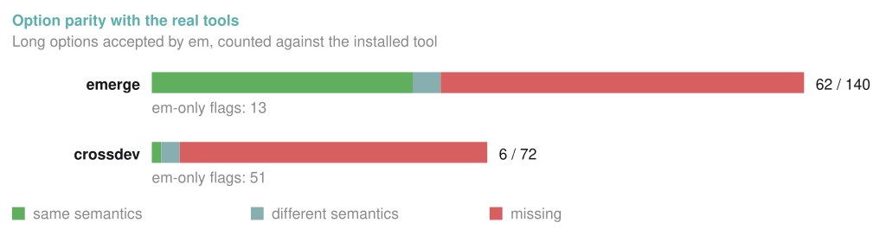
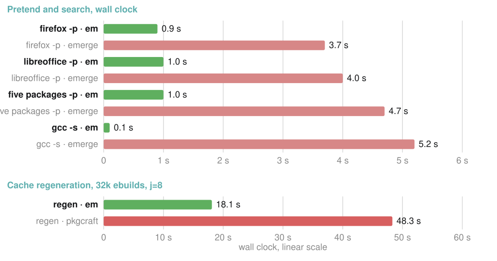

# portage-cli

[](LICENSE-MIT)
[](https://github.com/lu-zero/portage-cli/actions?query=workflow:CI)
[](https://deps.rs/repo/github/lu-zero/portage-cli)

A Rust reimplementation of the Gentoo Portage command-line tools, built on a
family of purpose-built crates for parsing atoms, metadata, repositories, and
the installed package database. `em` is the unified front-end binary; it
dispatches to subcommands corresponding to the traditional tools: `emerge`,
`equery`, `euse`, `emaint`, and others.

> **Note**: For a more mature Rust-based alternative, see
> [Pkgcraft](https://pkgcraft.github.io/).

> **Warning**: This codebase is currently mainly slop-coded and has not yet been
> thoroughly audited, some crates are already polished up to a degree and perform
> correctly. Use at your own risk.

> **Pre-release**: This is development source from `git`, before the first
> release of `portage-cli` and `em` on crates.io. See
> [`docs/design/architecture.md`](./docs/design/architecture.md) for the
> published/local-only breakdown.

## Applet status

Of the 28 applets, 20 are working and 8 are partial. The chart counts long
options of the two most important applets against the real tools:



<details>
<summary>All 28 applets</summary>

| Applet | Maps to | Status |
|--------|---------|--------|
| `atom` | — | Working |
| `query` | `equery` | Partial — [detail](./docs/user/applets.md#em-query-equery) |
| `use` | `euse` | Partial — [detail](./docs/user/applets.md#em-use-euse) |
| `pkg` | — | Working — edit `package.use` / `.accept_keywords` / `.mask` / `.env` |
| `maint` | `emaint` | Partial — [detail](./docs/user/applets.md#em-maint-emaint) |
| `sync` | `emaint sync` / `emerge --sync` | Working — `git` and `rsync` from `repos.conf` |
| `regen` | `emerge --regen` | Working |
| `search` | `emerge --search` | Working |
| *(default)* | `emerge` | Partial — [detail](./docs/user/applets.md#em-emerge); resolve → build loop, `-uD` in-slot upgrades, `--prefix` / multi-root |
| `ebuild` | `ebuild` | Working — fetch, unpack, phases, merge, VDB registration |
| `depclean` | `emerge --depclean` | Working — reverse-dep orphan clean (`-c`); world-aware |
| `quickpkg` | `quickpkg` | Working — GPKG from installed files / VDB `CONTENTS`; skips `CONFIG_PROTECT` by default |
| `mirrordist` | `emirrordist` | Working — [detail](./docs/user/applets.md#em-mirrordist-emirrordist) |
| `clean` | `eclean` | Working — [detail](./docs/user/applets.md#em-clean-eclean) |
| `revdep` | `revdep-rebuild` | Working — [detail](./docs/user/applets.md#em-revdep-revdep-rebuild) |
| `log` | `genlop` | Working — `current`/`list`/`time`/`predict`; see [docs/user/activity.md](./docs/user/activity.md) |
| `grep` | `qgrep` | Working — search ebuilds, eclasses or installed ebuild copies — [detail](./docs/user/applets.md#em-grep-qgrep) |
| `portageq` | `portageq` | Partial — the installed-package group (`has_version`, `best_version`, `match`, `mass_best_version`) — [detail](./docs/user/applets.md#em-portageq-portageq) |
| `read` | `elogv` / elog reader | Working — [detail](./docs/user/applets.md#em-read-elogv-and-the-elog-system) |
| `select` | `eselect` | Partial — `profile`, `repository`, `compiler`, `binutils`, `linker`, `clang`, `pkgconf`, `mirrors`, `news` (`eselect news`), `glsa` (`glsa-check`), … |
| `active` | — | Working — register default `--prefix`/`--local` for bare `em` |
| `setup` | — | Working — bootstrap a prefix layout (`--local` / `--prefix`) |
| `crossdev` | `crossdev` | Partial — [detail](./docs/user/crossdev.md#gaps-vs-crossdev); cross sysroot + staged toolchain bootstrap |
| `toolchain` | — | Working — native self-hosting toolchain bootstrap (`--root` / `--prefix` / `--local`) |
| `stages` | catalyst stage1/3 | Partial — `--stage1` (`packages.build`), `--stage3` (emptytree `@system`); no stage4 yet |
| `dispatch` | `dispatch-conf` | Working — alias of `etc` |
| `etc` | `etc-update` / `dispatch-conf` | Working — one command for both — [detail](./docs/user/applets.md#em-etc-etc-update-dispatch-conf) |
| `env` | `env-update` | Working — `profile.env` + `ld.so.conf` from `etc/env.d` |

</details>

[`docs/user/applets.md`](./docs/user/applets.md) has the per-applet detail,
gaps and benchmarks.

## Performance

Cold `em -p` against `emerge -p`, and `em -s` against `emerge -s`, on thalia,
an Ampere-1a server pinned to one NUMA node. Hyperfine medians, representative
of recent runs:



| Command | `em` | `emerge` | Speedup |
|---------|-----:|---------:|--------:|
| `firefox -p` | ~0.9 s | ~3.7 s | ~4× |
| `libreoffice -p` | ~1.0 s | ~4.0 s | ~4× |
| five packages `-p` | ~1.0 s | ~4.7 s | ~4.5× |
| `gcc -s` | ~0.1 s | ~5.2 s | ~50× |

Metadata cache regeneration on a 32k-ebuild tree at `j=8` took `em` 18.1 s
against pkgcraft's 48.3 s.

**Details:** [benchmark records](./benchmarks/BENCHMARKS.md) ·
[method and scripts](./benchmarks/README.md) ·
[machine](./benchmarks/machines/thalia.md).

## Documentation

### User guides

How to actually run `em`.

<details>
<summary>All user guides</summary>

| Doc | Covers |
|-----|--------|
| [`docs/user/intro.md`](./docs/user/intro.md) | **Start here** — what `em` is, quick start, topologies, common workflows |
| [`docs/user/cli/`](./docs/user/cli/index.md) | Generated flag-by-flag CLI reference (`em --help` in the terminal) |
| [`docs/user/root-model.md`](./docs/user/root-model.md) | `--root`, `--prefix`, `--config-root`, and the other location flags — builder-side recipes |
| [`docs/user/prefix-toolchain.md`](./docs/user/prefix-toolchain.md) | How to bootstrap and use a `--prefix`'s own compiler |
| [`docs/user/crossdev.md`](./docs/user/crossdev.md) | Cross-compilation targets (`--target`, `em crossdev`) |
| [`docs/user/binhost.md`](./docs/user/binhost.md) | Binary packages (`-b`/`-B`/`-k`/`-g`) and binhost identity model |
| [`docs/user/activity.md`](./docs/user/activity.md) | Structured progress/history/ETA (`em log`) |
| [`docs/user/applets.md`](./docs/user/applets.md) | Per-applet detail, gaps vs. the real tool, benchmarks |
| [`docs/user/stages-and-testing.md`](./docs/user/stages-and-testing.md) | Bootstrapping and validating a ROOT with `em stages` |

</details>

There is no dedicated `--local` user guide yet;
[`docs/user/stages-and-testing.md`](./docs/user/stages-and-testing.md) covers
the bootstrap. Remaining gaps are tracked under `todo/`.

### Design and architecture

How `em` is built, and why.

<details>
<summary>All design pages</summary>

| Doc | Covers |
|-----|--------|
| [`docs/design/architecture.md`](./docs/design/architecture.md) | Crate dependency graph, per-crate API catalog, `em -p` pipeline |
| [`docs/design/root-topology.md`](./docs/design/root-topology.md) | Design authority for the root/prefix/sysroot model — read this first |
| [`docs/design/cross-sysroot-spec.md`](./docs/design/cross-sysroot-spec.md) | How a cross target's spec becomes Portage config |
| [`docs/design/sync-backends.md`](./docs/design/sync-backends.md) | `em sync`'s git and gix backends, and what gix still lacks |
| [`docs/design/cargo-eb.md`](./docs/design/cargo-eb.md) | The `cargo eb` applet |
| [`docs/design/em-prefix-experiment.md`](./docs/design/em-prefix-experiment.md) | Why EPREFIX/multi-root bugs happen |
| [`docs/design/build-environment.md`](./docs/design/build-environment.md) | How phase env vars are resolved and read |
| [`docs/design/bash-crossdev-matrix.md`](./docs/design/bash-crossdev-matrix.md) | `em crossdev` vs. real bash-crossdev fidelity reference |
| [`docs/design/worker-build-tree.md`](./docs/design/worker-build-tree.md) | The unprivileged-build worker split |
| [`docs/design/dep-resolver.md`](./docs/design/dep-resolver.md) | Historical resolver investigation, superseded by architecture.md |
| [`docs/design/use-flags-api-design.md`](./docs/design/use-flags-api-design.md) | Effective-USE-flag API design notes |
| [`docs/design/testing.md`](./docs/design/testing.md) | Testing strategy, benchmarking, bumping the brush fork |
| [`docs/design/benchmarks.md`](./docs/design/benchmarks.md) | How to measure performance across the workspace |
| [`AGENTS.md`](AGENTS.md) | Contributor conventions: build commands, style, commit format |

</details>

Status trackers (open work, not reference docs) live under `todo/` — start
at [`todo/PENDING.md`](./todo/PENDING.md).

## Installation

```bash
cargo install --path portage-cli
```

## Development

See [AGENTS.md](AGENTS.md) for build commands, local dependency overrides,
and CI-parity checks.

## License

[MIT](LICENSE-MIT)

## Contributing

See [AGENTS.md](AGENTS.md) for project conventions (Conventional Commits,
style, checks).

## Author

Luca Barbato <lu_zero@gentoo.org>
