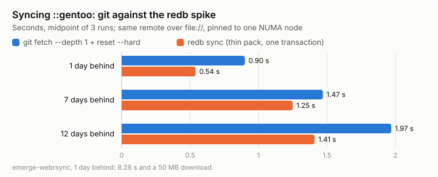
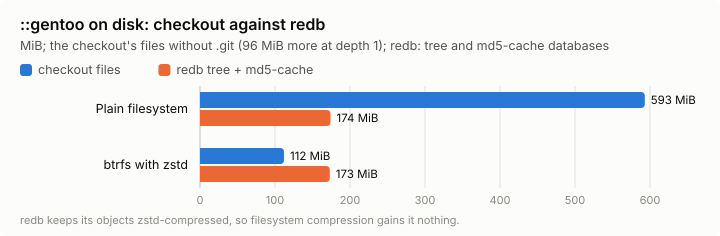
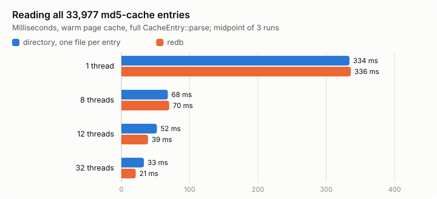
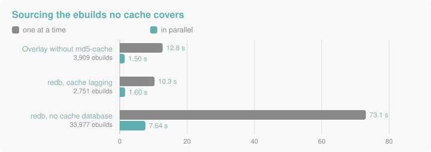

# The redb experiment: what storing ::gentoo in a database taught us

| Field | Value |
|---|---|
| Status | Experiment closed. The storage split is kept; the redb backend stays experimental behind the `redb` feature |
| Date | 2026-11-06 |
| Design | [`tree-storage.md`](./tree-storage.md) |
| Spike | branch `spike/redb-storage`, `spikes/tree-redb/` (`DESIGN.md`, `RESULTS.md`): the sync, size and md5-cache read figures |
| Host | thalia: Ampere-1a, 128 cores; runs pinned with `numactl -N 3 -m 3`, warm page cache unless stated |

The question was whether a Gentoo repository could live in one redb file, synced straight from
git, with no checkout. It can. The sync is the clear win; size and read speed are smaller wins
than they first looked. What lasts is the split it forced on em: a repository's bytes now come
from a `TreeSource` and its metadata from an `EntrySource`, whatever stores them.

## What was built

1. **The spike** (`spikes/tree-redb`): a sync that speaks git protocol v2, completes the thin pack
   from objects already in redb, checks the tip's signature, diffs the trees inside redb and
   applies everything in one write transaction. No `.git`, no worktree, no temporary files.
2. **The storage split** (`tree-source` branch, steps 1–5): every reader in `portage-repo`,
   `portage-resolve` and `portage-cli` goes through `Repository` and its tree, profiles included.
3. **A redb backend** behind the `redb` feature: `<location>.redb` holds the tree and
   `<location>.md5-cache.redb` the metadata entries, found next to the configured location.
4. **Builds without a checkout** (step 7): `inherit` reads eclasses through the trees, and only
   the package directory is made real, as a copy kept per tree.

## Results

### Sync

| Behind | git fetch + reset --hard | redb sync | Wire pack |
|---|---|---|---|
| 1 day | 0.83–0.97 s | 0.54 s | 106 KB |
| 7 days | 1.46–1.48 s | 1.25–1.26 s | 1.81 MB |
| 12 days | 1.96–1.98 s | 1.41 s | 3.83 MB |

Over GitHub, 12 days behind: 2.7–2.9 s against 3.5–5.3 s. `emerge-webrsync` for the 1-day case
takes 8.28 s and downloads 50 MB, the same as a first sync. `compact()` is 40% of
the 1-day redb sync; it keeps the file near its import size, which 14 daily syncs otherwise
fragment from 143 to 178 MiB.

### Size on disk

| | checkout files | `.git` (depth 1) | redb tree + md5-cache |
|---|---|---|---|
| Plain filesystem | 593 MiB | 96 MiB | 143 + 31 MiB |
| btrfs with zstd | 112 MiB | not measured | 173 MiB |

redb stores its objects zstd-compressed, so filesystem compression gains it nothing. On a
compressing filesystem the checkout's files are smaller than the database, and the saving is
only the `.git` directory.

### Reading the metadata

| Threads | directory | redb |
|---|---|---|
| 1 | 318–350 ms | 335–336 ms |
| 8 | 61–76 ms | 66–74 ms |
| 12 | 46–57 ms | 38–40 ms |
| 32 | 33 ms | 20–21 ms |

Most of the gain is parallelism, which a directory read gets too; redb's own edge is 10–15 ms
at 12 and 32 threads. In em, with the checkout and the redb tree at the same commit:

| | checkout | redb |
|---|---|---|
| Valid entries for `::gentoo` (`repo_load` bench) | 70 ms | 55 ms |
| `em -p @world`, warm, 15 runs | 934 ± 41 ms | 920 ± 40 ms |
| `em -p @world`, cold page cache, 5 runs | 1.32–1.42 s, 124 MiB read | 1.19–1.25 s, 119 MiB read |
| `em search -S`, warm, fastest of 60 runs | 62 ms | 76 ms: every entry is decompressed |

Both produce the same `@world` plan and the same search output. The cold read is about the
same size: what redb saves on the md5-cache it reads back as tree objects for profiles.

### Ebuilds no cache covers

| Case | before | after |
|---|---|---|
| Overlay without md5-cache, 3,909 ebuilds, cold | 12.75 ± 0.08 s | 1.50 ± 0.02 s |
| Same overlay, entries in em's cache | 409 ± 13 ms | 413 ± 19 ms |
| redb, cache database a sync behind, 2,751 ebuilds, cold | 10.34 ± 0.06 s | 1.60 ± 0.01 s |
| Same, entries in em's cache | 858 ± 16 ms | 637 ± 16 ms |
| redb, no cache database, 33,977 ebuilds, cold | 73.1 s | 7.64 ± 0.06 s |
| Same, entries in em's cache | 2.58 ± 0.01 s | 0.73 ± 0.03 s (0.62 s with the cache database) |
| `em regen` of the `::gentoo` checkout, for reference | 7.06 s | 7.06 s |

"Before" is the branch's gap-filling commit, which sourced one ebuild at a time; master found
no entries at all for a redb tree with no cache database.

The redb backend exposed it, but the slow path was em's own: ebuilds without a valid entry were
checked and sourced one at a time on every backend.

### Cost on the default path

Release builds, branch against master, without the `redb` feature:

| | master | branch |
|---|---|---|
| `em -p @world`, warm, 15 runs | 851 ± 10 ms | 855 ± 9 ms |

The tree indirection, `inherit` reading through it and the build changes cost nothing
measurable.

## What we learned

1. **Sync is where a database pays.** One thin pack and one transaction beat `git fetch` plus
   `reset --hard` at every delta, and leave no worktree to repair. The tree is always one
   signed commit, so its entries need no freshness check.
2. **Size depends on the filesystem.** Against an uncompressed checkout redb is a quarter of the
   size; on btrfs with zstd the checkout's own files are smaller, and only `.git` is saved.
3. **Parallel reads matter more than the container.** A directory read in parallel is almost as
   fast as redb. Cold, redb is 10% faster with about the same bytes read; warm they are equal.
4. **The tree and the metadata cache live different lives.** They became two files: the cache
   can lag the tree, run ahead of it, or be missing. Each backend says which entries it lacks;
   filling them is shared code, the same pool `em regen` uses.
5. **A build needs one real directory, not a checkout.** `FILESDIR`, `EBUILD` and the Manifest
   need the package directory on disk. Ebuild text is parsed from memory and eclasses are read
   through the trees. The first step-7 attempt copied `eclass/` and the repository's identity
   files and opened the copy as the repository; tracing a real build showed nothing read the
   eclass directory, and the copy hid `profiles/thirdpartymirrors`. The claim that libtool
   needs `ELT-patches` beside its eclass was wrong: they now come from `app-portage/elt-patches`.
   The spike's notes had already proposed this split; the shortcut ignored them.
6. **Measure before claiming, and on matching inputs.** Each wrong turn above was a belief that
   a trace, a profile or the reference tool corrected: the eclass directory, the sequential gap
   path, and redb's locking. An earlier cold-cache figure (99 against 124 MiB) came from a build
   that still read profiles and eclasses from the checkout; and a redb tree from another commit
   than the checkout made an overlay's cache look stale on every run. Re-measured on one commit,
   the reads are 119 against 124 MiB.
7. **redb's readers and its writer exclude each other.** In its default mode both lock the file
   at open, so a running em keeps a sync from starting; the spike's notes said readers were
   unaffected.
8. **An independent review finds what the author stops seeing.** It found that pruning old
   copies could delete one another em was building from, that the hakoniwa sandbox did not bind
   the databases, and that `em regen` would build a checkout skeleton at a redb location.

## Open

- **Staleness:** a database next to a repository synced another way is warned about when
  `repos.conf` is loaded; nothing yet warns when a `git-redb` repository goes unsynced for long.
- **`em search -S`:** 25% slower from redb, because every entry is decompressed.
- **Storage:** the md5-cache is stored twice, as tree objects and in the cache database.
- **Sync in em:** done since, see [Schema and sync in em](./tree-storage.md#schema-and-sync-in-em):
  em owns the schema and `sync-type = git-redb` imports and syncs. Compaction policy, one
  repository per file and the import's peak memory remain as the spike left them.
- **Locking:** em and a sync cannot have the same database open; redb's multi-process modes are
  untried.
