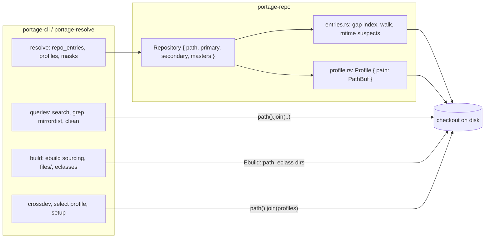
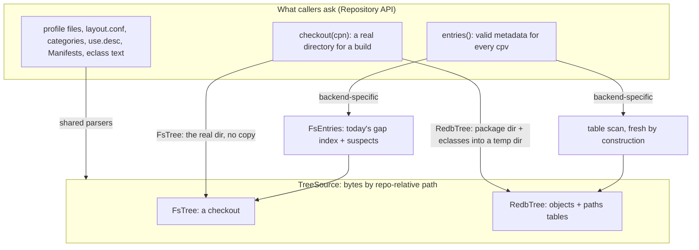
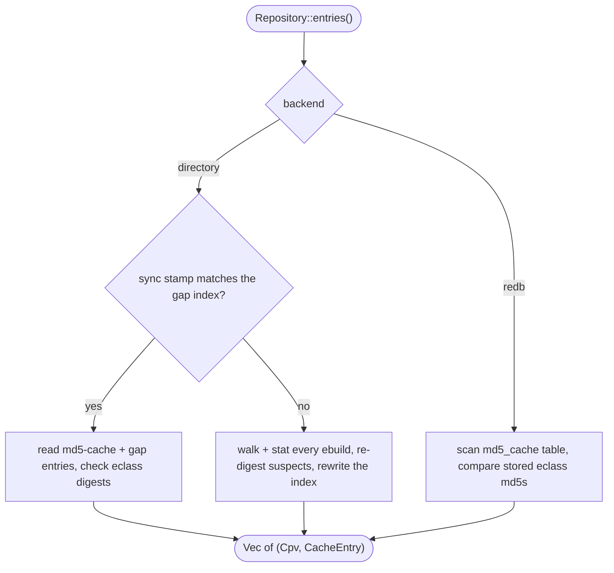
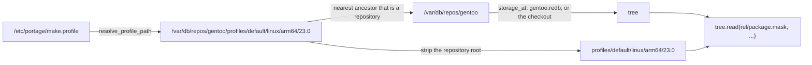
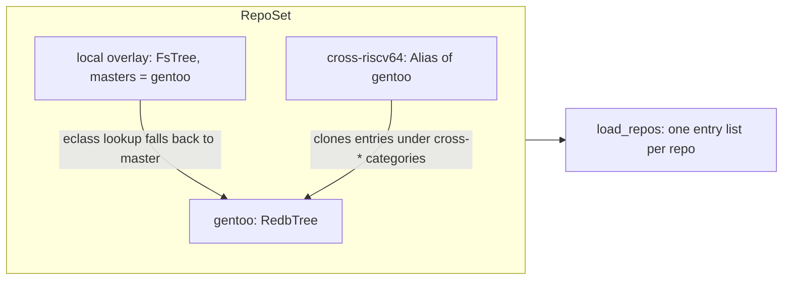
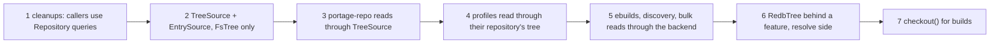

# Repository storage backends

| Field | Value |
|---|---|
| Status | Steps 1–5 done; builds (step 7) still need a checkout. Experimental redb backend behind the `redb` feature. Decisions recorded 2026-11-05 |
| Date | 2026-11-05 |
| Scope | `portage-repo`'s `Repository`, and the callers in `portage-resolve` and `portage-cli` that reach into the tree by path |
| Non-scope | Host configuration (`/etc/portage`), the installed-package database, binpkgs |

Today a `Repository` *is* a directory: every reader joins a path onto `Repository::path()` and
calls `std::fs`. This page sketches splitting what a caller wants from the tree (an entry, a
profile file, an eclass) from how it is stored, so a repository can also live in one redb file
synced straight from git.

## Why

A `::gentoo` checkout is 132,574 files. em reads it in three ways, each with its own cost:

| | directory | redb (spike for sync, `repo_load` bench and `em -p @world` for the rest) |
|---|---|---|
| Sync, 1–12 days behind | git fetch + `reset --hard`: 0.83–1.96 s | fetch, resolve, apply in one transaction: 0.54–1.41 s |
| Entries, unchanged tree | 71–76 ms (139 ms counting freeing them): gap index, read 34k files, eclass digests | 56 ms: merge the ebuild and md5-cache tables, compare stored md5s |
| Entries, first run after a sync | 415 ms: stat 34k ebuilds, re-digest ~5k whose mtime moved | same as the unchanged case: the tree came from one verified commit |
| `em -p @world`, cold page cache | 1.40 s, 124 MiB read | 1.33 s, 99 MiB read |

The spike lives on the `spike/redb-storage` branch (`spikes/tree-redb`).

## Today



Outside `portage-repo` about 20 places reach into the tree by path, plus the build side and the
profile code; [What still uses paths](#what-still-uses-paths) lists what is left.

## Proposed layers



Three levels, because they differ in who owns the logic:

1. **`TreeSource`** reads bytes. The parsers (profiles, `layout.conf`, categories, sets, USE
   descriptions, Manifests) stay shared and stop caring where bytes come from.
2. **Entries** are answered by each backend. The directory backend's freshness machinery (mtimes,
   gap index, md5 re-digests) only exists because files change under em; a redb tree is one
   commit, so its answer is a table read. Building entries on top of `TreeSource` would make the
   redb backend pay for checks it does not need.
3. **Checkout** gives the build a real directory: ebuild sourcing, `files/`, `eapply` and the
   binpkg/VDB copy of the ebuild all need paths.

### Sketch

```rust
/// Bytes of one repository's tree, addressed by repo-relative path
pub trait TreeSource: Send + Sync {
    /// `Ok(None)` when the file does not exist
    fn read(&self, rel: &Utf8Path) -> Result<Option<Bytes>>;
    /// Names of the immediate children of `rel`, with their kind
    fn list(&self, rel: &Utf8Path) -> Result<Vec<(String, EntryKind)>>;
    fn kind(&self, rel: &Utf8Path) -> Result<Option<EntryKind>>;
    /// A real directory holding `rels`; the directory backend returns its own path
    fn checkout(&self, rels: &[&Utf8Path]) -> Result<Checkout>;
}

/// How a backend produces the valid metadata entries
#[async_trait]
pub trait EntrySource: Send + Sync {
    async fn entries(&self, repo: &Repository) -> Vec<(Cpv, CacheEntry)>;
}

pub struct Repository {
    tree: Arc<dyn TreeSource>,
    entries: Arc<dyn EntrySource>,
    layout: LayoutConf,
    name: Interned<DefaultInterner>,
    secondary: Arc<dyn MetadataCache>,
    masters: Vec<Repository>,
}
```

`Repository::path()` goes away from the public API. A caller that truly needs a path (the sync
code on a checkout, `em regen` writing the md5-cache) asks the directory backend for it
explicitly, so a redb repository answers "not a checkout" instead of a path that does not exist.

`list` on redb walks git tree objects from the root tree id rather than range-scanning the
`paths` table: listing the repository root would otherwise scan all 132k keys.

## Entries per backend



The secondary cache (`MetadataCache`, em's own store for overlays without an md5-cache) is
unchanged: both backends can still fall back to sourcing an ebuild and writing the result there.

## Profiles

A profile is still named by a path: `/etc/portage/make.profile` is a symlink to
`<location>/profiles/...`, and `parent` lines resolve by joining paths. What changed is where its
files come from: `Profile` keeps the tree of the repository enclosing it and its directory in
that tree, and reads every file through it, `make.defaults` included (evaluated as text).



- A repository is recognised by `metadata/layout.conf`, `profiles/repo_name`, or a tree database
  next to its location, so the location needs no directory when the repository lives in redb.
- `resolve_profile_path` canonicalizes as before. A path that does not exist on disk is resolved
  by hand (link targets, `..`) and accepted only inside a repository stored elsewhere; such a
  profile must then exist in that repository's tree.
- One tree per repository is opened per stack build.
- `/etc/portage/profile` has no enclosing repository and reads its own directory.
- `em select profile` writes the same symlink as today.

A separate `ProfileId { repo, rel }` type turned out not to be needed: the location `repos.conf`
gives a repository already identifies it, and every profile file read goes through the tree.

## Composition

Masters and alias repositories work at the level above storage, so they mix backends freely:



- An overlay on disk can name a redb `::gentoo` as its master: eclass lookup goes through the
  master's `TreeSource`, and the build checkout copies the eclasses it inherits.
- An alias repository has no tree. `load_repos` clones its source's entries, so it works on any
  backend unchanged. Its build path (`PlannedMerge.ebuild_path`) becomes a checkout of the
  source package.

## Sync and interop

- A redb repository syncs itself: protocol-v2 fetch of a thin pack, signature check of the tip,
  one write transaction. Readers see the old or new tree, never a mix, so `em -p` can run during
  a sync.
- Portage still needs a checkout. A Portage sync module (`sync-type`) can call em to sync the
  database, then write only that sync's changed files into the checkout. That keeps one fetch
  and one source of truth; it does not save the checkout's disk space.

## What stays on the filesystem

- `/etc/portage` (`make.conf`, `package.*`, `repos.conf`), the installed-package database,
  binpkgs.
- Writers: `em regen` filling the in-tree md5-cache, `em select repos` and `em setup` creating
  repositories, `regen_use` writing `use.local.desc`. On a redb repository they refuse.

## Migration



Steps 2–5 change no behaviour and are checked against the `repo_load` and `resolve` benches.
Steps 1–5 are on the `tree-source` branch:

1. Callers read Manifests and cache entries through `Repository` (748f93f6).
2. `TreeSource`, `EntrySource` and `Storage` (tree, entries, primary cache), the checkout by default.
3. `Repository`'s own files, `Category`, `Package` and the USE descriptions read through the tree.
4. Profiles read through the tree of the repository enclosing them, `make.defaults` included.
5. Ebuilds read through their repository's tree; discovery uses the backend's index when it keeps
   one; bulk md5-cache reads take the backend's stored entries; mask explanations, alias entries,
   `em grep`, `em query`, `em info` and moveinst read through the tree.

With `::gentoo` only in redb, no checkout at its location, `em -pv @world`, `em pkg use`,
`em query`, `em search` and `em grep` give the checkout's output; `em query which` and mask
explanations name files with `redb://` URIs.

### What still uses paths

| kind | sites | why, or what it becomes |
|---|---|---|
| Builds | `PlannedMerge.ebuild_path`, `Ebuild::path`, `build/shell.rs` (eclass lookup, `files/`, sourcing), `profile.bashrc`, binpkg and VDB copies of the ebuild, `em ebuild fetch` reading the Manifest, crossdev sourcing `multilib.eclass`; sourcing an ebuild whose metadata is not cached (overlays without md5-cache, alias packages) | step 7: a `Checkout` with the package directory and its inherited eclasses |
| The directory backend's own work | gap index, sync stamp, mtime suspects, md5-cache walk, `search.rs`'s symlinked-ebuild fallback | checkout-only by nature |
| Identity from the directory name | `mirrordist.rs` keys its default deletion database on it | switching to `repo.name()` could orphan an existing database |
| Raw `repos.conf` walks | `clean.rs` `declared_categories` (falls back to hyphenated directory names without `profiles/categories`) | moving it to `Repository` changes behaviour |
| Profile paths written out | crossdev builds profile paths into crossdev's config | paths are what the config holds |
| Writers | `setup/repo.rs`, `select/repos.rs`, `regen_use.rs`, `em regen` | directory backend only; a redb repository refuses |
| Configuration | `repo_open.rs` compares locations, `info.rs` `resolve_volatile` | sync owns the checkout |

## Decisions

- **`EntrySource` is async**, like `repo_entries` today: it spreads 34k entries over workers.
  `TreeSource` stays sync even though the shell is async: both backends read with blocking calls
  (a local `read(2)`, redb's sync API), and the eclass parse cache reads inside a closure that
  cannot await. Async callers call it directly, as they call `std::fs` today.
- **Eclass and ebuild digests stay md5**, as the md5-cache records them. The redb tree stores the
  md5 of each eclass and ebuild when it writes the tree, so entries convert both ways: a checkout
  exported from the database, or a database imported from a checkout, carries a valid md5-cache.
  The redb backend does not re-digest on read; a tree edited locally is a directory repository.
- **One tree database per repository**, plus its md5-cache database. Masters, overlays and
  aliases keep their own storage, and a repository can switch backend without touching the others.
- **The files live next to the location** (`<location>.redb`, `<location>.md5-cache.redb`): em
  opens repositories by path in many places before `repos.conf` is read.

## `Ebuild::path`

`Ebuild::path` has 44 uses. They fall into five roles, and each maps to something other than a
path:

| Role | Uses | Becomes |
|---|---|---|
| Read the content | md5 of the ebuild (`entries.rs:517`), `em grep` text, `metadata.xml` next to it (`query/uses.rs:33`), the Manifest for `em ebuild fetch` | `Ebuild::read()`, `Package::metadata_xml()`, `Package::manifest()` through `TreeSource` |
| Identity | "already sourced this phase?" memo (`build/shell.rs:1263,1985`) | `(repo, cpv)` |
| Symlinked ebuilds (crossdev symlink overlays) | `canonicalize` to find the master's entry (`entries.rs:669`, `search.rs:324`) | directory backend only; a redb tree has no symlinks into other repos |
| Build environment | `source` by path, `EBUILD` (PMS 11.1 asks for an absolute path), `FILESDIR` = ebuild dir + `files`, copying the ebuild into the binpkg and the VDB | `Checkout`: a real directory, the repo's own for the directory backend |
| Shown to the user | `em query which` prints it, `em grep` path labels, error messages | the location path `repos.conf` gives; see below |

`Ebuild` keeps its repository's tree and its path in it (`path_in_repo`); reading, `metadata.xml`
and `display()` (the name shown) go through the tree. `path()` remains for the build until it runs
from a `Checkout`.

What em shows for a file in a redb repository is a URI naming the database file and the path
inside it: `redb:///var/db/repos/gentoo.redb?sys-apps/portage/portage-3.0.70.ebuild`. `em query
which`, `em grep` labels and error messages use it. The build environment never sees it: `EBUILD`
and `FILESDIR` point into the `Checkout`. The path part is written as-is (`+` is literal in an RFC
3986 query); only `%`, `#`, spaces and control characters are percent-encoded, which PMS names never
contain and only arbitrary files under `files/` might.

## redb layout

Two files per repository, next to the location `repos.conf` gives, because the tree and the
md5-cache have separate lifecycles:

| file | written by | tables |
|---|---|---|
| `<location>.redb` | sync | `objects` (git objects by oid), `paths`, `ebuilds` (`cat/PF` → md5), `eclasses` (name → md5), `packages`, `meta`, `sync_log` |
| `<location>.md5-cache.redb` | sync now; `em regen` or sourcing later | `entries` (`cat/PF` → entry text), `meta` (the tree commit it was copied from) |

An entry is valid when its `_md5_` and `_eclasses_` match the tree's `ebuilds` and `eclasses`
tables, so the cache may lag behind or run ahead of the tree. Loading the entries merges the two
ordered tables, split at category names across workers. `metadata/md5-cache/` also stays in the
tree as ordinary files: sync applies git diffs to it.

## Measured (2026-11-05, `tree-source` branch)

`::gentoo` at one commit, both redb files imported from the same commit, pinned to one NUMA node.
The bench times entries without freeing them (`iter_with_large_drop`): freeing 34k entries costs
~65 ms in either backend, and em does it off the caller's thread.

| | master | branch, checkout | branch, redb |
|---|---|---|---|
| entries, unchanged tree (bench) | 73–75 ms | 71–76 ms | 56 ms |
| `profile_updates` (~70 small files, bench) | 411 µs | 395 µs | 448 µs |
| `em -p @world`, warm | 945 ± 20 ms | 940 ± 25 ms | 950 ± 39 ms (system 277 ms against 431) |
| `em -p @world`, cold page cache | | 1.404 ± 0.012 s, reads 124 MiB | 1.333 ± 0.065 s, reads 99 MiB |

- The `dyn TreeSource` indirection costs nothing measurable.
- Warm, the entries saving disappears in a ~0.95 s run; redb trades system time for zstd decoding.
- Cold, redb reads the 31 MiB cache file in one pass and 5 MiB of the tree file. With the md5-cache
  keyed by oid inside the tree file, the same run read 264 MiB and was the slowest of the three.
- redb small reads are ~13% slower: one read transaction and a zstd decode per file.
- Space depends on the filesystem. On btrfs with `compress=zstd:3` the checkout's files take
  112 MiB (`compsize`; 124k of the 132k files are stored inline in btrfs metadata), less than
  the two redb files (173 MiB, already zstd, so btrfs leaves them as they are). Syncing needs the
  checkout plus `.git` (~210 MiB of packs), so redb still about halves that. Without compression,
  e.g. ext4 with 4 KiB blocks, the checkout's files take about 593 MiB (one block or more per file)
  and redb saves roughly three quarters.
- redb stores the md5-cache twice: as git objects in the tree file (the bases sync diffs against)
  and in the cache file, 31 MiB each.
- Incremental cache update over a 12-day sync: 2564 entries written, 1565 removed, 267 ms including
  compaction; the result matches a full rebuild.

## Open questions

- **Blocking reads in the async shell.** `inherit` reads and parses eclasses inside the parse
  cache's synchronous `get_or_insert_with` closure, and sourcing, `FILESDIR` and `eapply` use
  `std::fs` from async functions. Find out what that costs on a busy runtime (tokio worker
  threads blocked on I/O during parallel sourcing) before settling `TreeSource`'s shape for good.
