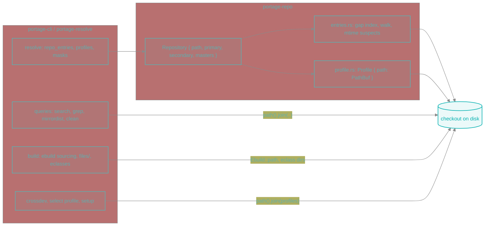
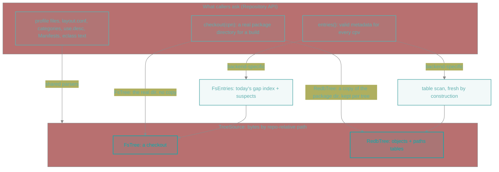
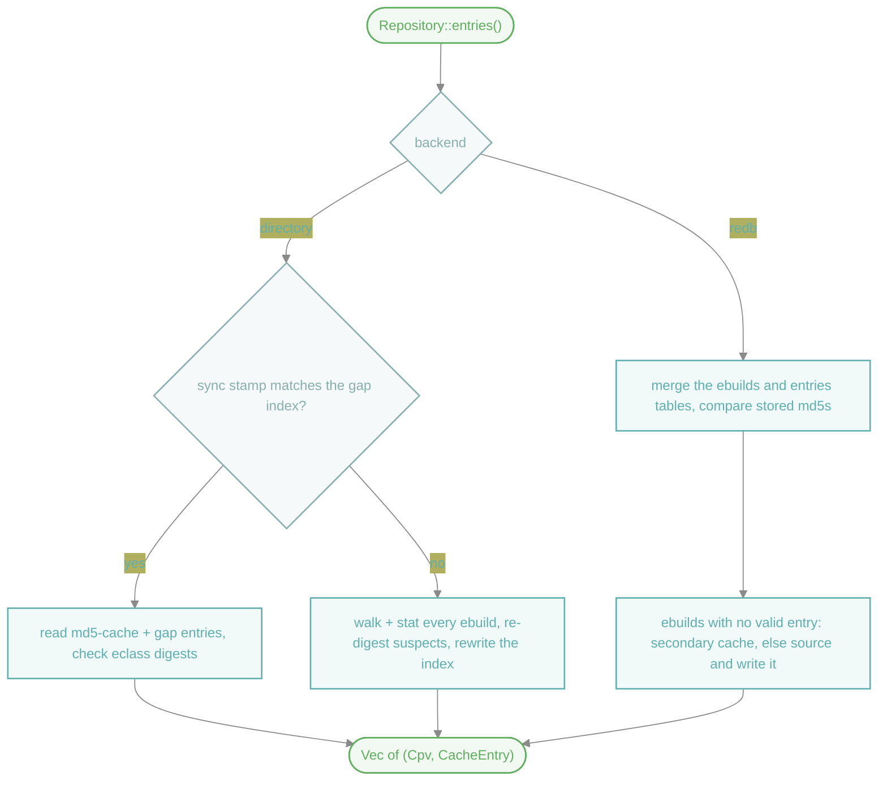
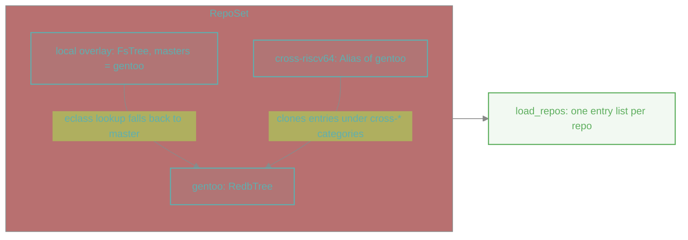
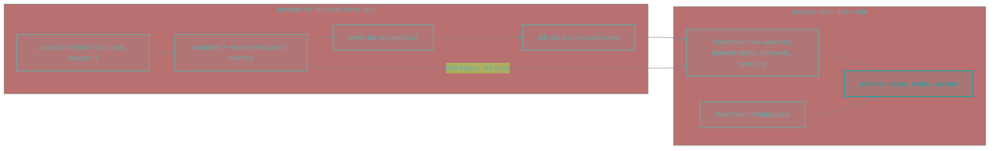

# Repository storage backends

| Field | Value |
|---|---|
| Status | Steps 1–7 done; em writes and syncs the redb databases (`sync-type = git-redb`). Experimental, behind the `redb` feature. Decisions recorded 2026-11-05 and 2026-11-07 |
| Date | 2026-11-05 |
| Scope | `portage-repo`'s `Repository`, and the callers in `portage-resolve` and `portage-cli` that reach into the tree by path |
| Non-scope | Host configuration (`/etc/portage`), the installed-package database, binpkgs |
| Results | [`tree-storage-experiment.md`](./tree-storage-experiment.md): measurements and what the experiment taught |

Today a `Repository` *is* a directory: every reader joins a path onto `Repository::path()` and
calls `std::fs`. This page sketches splitting what a caller wants from the tree (an entry, a
profile file, an eclass) from how it is stored, so a repository can also live in one redb file
synced straight from git.

## Why

A `::gentoo` checkout is 132,574 files. em reads it in three ways, each with its own cost:

| | directory | redb (spike for sync, `repo_load` bench and `em -p @world` for the rest) |
|---|---|---|
| Sync, 1–12 days behind | git fetch + `reset --hard`: 0.83–1.96 s | fetch, resolve, apply in one transaction: 0.54–1.41 s |
| Entries, unchanged tree | 71–76 ms (139 ms counting freeing them): gap index, read 34k files, eclass digests | 56 ms: merge the ebuild and md5-cache tables, compare stored md5s |
| Entries, first run after a sync | 415 ms: stat 34k ebuilds, re-digest ~5k whose mtime moved | same as the unchanged case: the tree came from one verified commit |
| `em -p @world`, cold page cache | 1.32–1.42 s, 124 MiB read | 1.19–1.25 s, 119 MiB read |

The spike lives on the `spike/redb-storage` branch (`spikes/tree-redb`); its sync and schema now
live in em, see [Schema and sync in em](#schema-and-sync-in-em).

## Today



Outside `portage-repo` about 20 places reach into the tree by path, plus the build side and the
profile code; [What still uses paths](#what-still-uses-paths) lists what is left.

## Proposed layers



Three levels, because they differ in who owns the logic:

1. **`TreeSource`** reads bytes. The parsers (profiles, `layout.conf`, categories, sets, USE
   descriptions, Manifests) stay shared and stop caring where bytes come from.
2. **Entries** are answered by each backend. The directory backend's freshness machinery (mtimes,
   gap index, md5 re-digests) only exists because files change under em; a redb tree is one
   commit, so its answer is a table read. Building entries on top of `TreeSource` would make the
   redb backend pay for checks it does not need.
3. **Checkout** gives the build a real package directory, because `FILESDIR` and `EBUILD` are
   paths. The ebuild text, eclasses and the repository's own files are read through the tree.

### Traits

```rust
/// Bytes of one repository's tree, addressed by repo-relative path
pub trait TreeSource: Send + Sync {
    /// `Ok(None)` when it does not exist or is a directory
    fn read(&self, rel: &Utf8Path) -> io::Result<Option<Vec<u8>>>;
    /// `Ok(None)` when it does not exist or is not a directory
    fn list(&self, rel: &Utf8Path) -> io::Result<Option<Vec<(String, EntryKind)>>>;
    fn kind(&self, rel: &Utf8Path) -> io::Result<Option<EntryKind>>;
    /// A path, or a `redb://` URI
    fn display(&self, rel: &Utf8Path) -> String;
    /// Every `cat/pkg/*.ebuild`, when the backend indexes them; `None` walks the tree
    fn ebuild_index(&self) -> Option<io::Result<Vec<Utf8PathBuf>>> { None }
    /// A real directory holding `rels`: the checkout itself, or a copy under `copies`
    fn checkout(&self, rels: &[&Utf8Path], copies: Option<&Utf8Path>) -> io::Result<Utf8PathBuf>;
    /// Whether writers may change the tree in place
    fn is_checkout(&self) -> bool;
}

/// How a backend produces the valid metadata entries
pub trait EntrySource: Send + Sync {
    fn entries<'a>(&'a self, repo: &'a Repository) -> BoxFuture<'a, Vec<(Cpv, CacheEntry)>>;
    /// Stored entry texts, unchecked; `None` reads the checkout's md5-cache directory
    fn raw_entries(&self, latest_per_cpn: bool) -> Option<io::Result<Vec<(Cpv, String)>>> { None }
}

/// What `Repository` holds instead of a bare directory
pub struct Storage {
    pub tree: Arc<dyn TreeSource>,
    pub entries: Arc<dyn EntrySource>,
    pub primary: Arc<dyn MetadataCache>,
}
```

`Repository::path()` stays as the repository's location, which identifies it and keys its
copies; readers go through the tree. A writer that needs the directory checks
`Repository::stored_elsewhere()` (the tree is not a checkout) first, instead of writing under a
path that does not exist.

`list` on redb walks git tree objects from the root tree id rather than range-scanning the
`paths` table: listing the repository root would otherwise scan all 132k keys.

## Entries per backend



Finding what lacks a valid entry is per backend; filling it is shared, on the worker pool `em
regen` uses. The redb merge sees each ebuild with no entry, an `_md5_` that differs or a stale
eclass, so a cache database lagging the tree, or missing, costs one sourcing of those ebuilds
(all 34k: about 8 s, as long as `em regen`), then reads of em's secondary cache.

## Profiles

A profile is still named by a path: `/etc/portage/make.profile` is a symlink to
`<location>/profiles/...`, and `parent` lines resolve by joining paths. What changed is where its
files come from: `Profile` keeps the tree of the repository enclosing it and its directory in
that tree, and reads every file through it, `make.defaults` included (evaluated as text).

```mermaid
---
config:
  theme: base
  themeVariables:
    fontFamily: "ui-sans-serif,system-ui,Segoe UI,Helvetica,Arial,sans-serif"
    fontSize: "14px"
    primaryColor: "#5fafaf"
    primaryTextColor: "#5fafaf"
    primaryBorderColor: "#5fafaf"
    lineColor: "#8a8a8a"
    textColor: "#8a8a8a"
    titleColor: "#5fafaf"
    clusterBorder: "#8a8a8a"
  themeCSS: >
    .cluster rect { fill: #8a8a8a !important; fill-opacity: 0.06 !important; }
    .edgeLabel, .edgeLabel p, .edgeLabel span, .labelBkg { background: none !important; background-color: transparent !important; }
    .edgeLabel, .edgeLabel p, .edgeLabel span { color: #5faf87; }
    .edgeLabel rect { fill: none !important; }
---
flowchart LR
  link["/etc/portage/make.profile"] -->|"resolve_profile_path"| abs["/var/db/repos/gentoo/profiles/default/linux/arm64/23.0"]
  abs -->|"nearest ancestor that is a repository"| repo["/var/db/repos/gentoo"]
  repo -->|"storage_at: gentoo.redb, or the checkout"| tree["tree"]
  abs -->|"strip the repository root"| rel["profiles/default/linux/arm64/23.0"]
  tree --> read["tree.read(rel/package.mask, ...)"]
  rel --> read
  classDef default fill:#5fafaf14,stroke:#5fafaf,stroke-width:1.5px,color:#5fafaf
  classDef result fill:#5faf5f14,stroke:#5faf5f,stroke-width:1.5px,color:#5faf5f
  classDef store fill:#00afaf14,stroke:#00afaf,stroke-width:1.5px,color:#00afaf
  class tree store
  class read result
```



- A repository is recognised by `metadata/layout.conf`, `profiles/repo_name`, or a tree database
  next to its location, so the location needs no directory when the repository lives in redb.
- `resolve_profile_path` canonicalizes as before. A path that does not exist on disk is resolved
  by hand (link targets, `..`) and accepted only inside a repository stored elsewhere; such a
  profile must then exist in that repository's tree.
- One tree per repository is opened per stack build.
- `/etc/portage/profile` has no enclosing repository and reads its own directory.
- `em select profile` writes the same symlink as today.

A separate `ProfileId { repo, rel }` type turned out not to be needed: the location `repos.conf`
gives a repository already identifies it, and every profile file read goes through the tree.

## Composition

Masters and alias repositories work at the level above storage, so they mix backends freely:



- An overlay on disk can name a redb `::gentoo` as its master: `inherit` reads eclasses through
  the master's `TreeSource`, so nothing of the master is copied.
- An alias repository has no tree. `load_repos` clones its source's entries, so it works on any
  backend unchanged. Its plan entry (`PlannedMerge.ebuild`) names the source repository's
  ebuild, whose package directory the build makes real.

## Sync and interop

- `em sync` syncs a `sync-type = git-redb` repository itself: protocol-v2 fetch of a thin pack,
  signature check of the tip, one write transaction, so the tree is the old one or the new one,
  never a mix. In redb's default mode a reader and the sync's writer lock the file against each
  other at open: an em running keeps a sync from starting, and the other way round.
- Portage still needs a checkout. A Portage sync module (`sync-type`) can call em to sync the
  database, then write only that sync's changed files into the checkout. That keeps one fetch
  and one source of truth; it does not save the checkout's disk space.

## What stays on the filesystem

- `/etc/portage` (`make.conf`, `package.*`, `repos.conf`), the installed-package database,
  binpkgs.
- Writers: `em regen` filling the in-tree md5-cache, `em select repos` and `em setup` creating
  repositories, `regen_use` writing `use.local.desc`. On a redb repository `em regen` writes em's
  secondary cache instead and `regen_use` asks for `-o`; `em sync` writes the databases of a
  `git-redb` repository and never a checkout. A database next to a repository synced any other way
  is warned about when `repos.conf` is loaded, since it is read in place of the checkout sync updates.

## Migration

```mermaid
---
config:
  theme: base
  themeVariables:
    fontFamily: "ui-sans-serif,system-ui,Segoe UI,Helvetica,Arial,sans-serif"
    fontSize: "14px"
    primaryColor: "#5fafaf"
    primaryTextColor: "#5fafaf"
    primaryBorderColor: "#5fafaf"
    lineColor: "#8a8a8a"
    textColor: "#8a8a8a"
    titleColor: "#5fafaf"
    clusterBorder: "#8a8a8a"
  themeCSS: >
    .cluster rect { fill: #8a8a8a !important; fill-opacity: 0.06 !important; }
    .edgeLabel, .edgeLabel p, .edgeLabel span, .labelBkg { background: none !important; background-color: transparent !important; }
    .edgeLabel, .edgeLabel p, .edgeLabel span { color: #5faf87; }
    .edgeLabel rect { fill: none !important; }
---
flowchart LR
  s1["1 cleanups: callers use Repository queries"] --> s2["2 TreeSource + EntrySource, FsTree only"]
  s2 --> s3["3 portage-repo reads through TreeSource"]
  s3 --> s4["4 profiles read through their repository's tree"]
  s4 --> s5["5 ebuilds, discovery, bulk reads through the backend"]
  s5 --> s6["6 RedbTree behind a feature, resolve side"]
  s6 --> s7["7 checkout() for builds"]
  classDef default fill:#5fafaf14,stroke:#5fafaf,stroke-width:1.5px,color:#5fafaf
```



Steps 2–5 change no behaviour and are checked against the `repo_load` and `resolve` benches.
Steps 1–7 are on the `tree-source` branch:

1. Callers read Manifests and cache entries through `Repository` (748f93f6).
2. `TreeSource`, `EntrySource` and `Storage` (tree, entries, primary cache), the checkout by default.
3. `Repository`'s own files, `Category`, `Package` and the USE descriptions read through the tree.
4. Profiles read through the tree of the repository enclosing them, `make.defaults` included.
5. Ebuilds read through their repository's tree; discovery uses the backend's index when it keeps
   one; bulk md5-cache reads take the backend's stored entries; mask explanations, alias entries,
   `em grep`, `em query`, `em info` and moveinst read through the tree.
6. The redb backend and its `em` wiring, behind the `redb` feature.
7. A build opens its repository by the location the plan carries, and `inherit` reads eclasses
   through the trees of the repository and its masters, so `_eclasses_` digests come from the
   text sourced. Only the package directory must be real, for `FILESDIR`, `EBUILD` and the
   Manifest: a checkout's own, or for redb a copy under `/var/cache/edb/em-checkout` as root
   (otherwise `$XDG_CACHE_HOME/em/checkout`), keyed by location and tree, staged and renamed
   whole. Using a copy refreshes its time; copies unused for a week are pruned, so an em still
   building from an older tree keeps its files. The hakoniwa sandbox binds the databases and
   the copies.

With `::gentoo` only in redb, no checkout at its location, `em -pv @world`, `em pkg use`,
`em query`, `em search` and `em grep` give the checkout's output; `em query which` and mask
explanations name files with `redb://` URIs.

### What still uses paths

| kind | sites | why, or what it becomes |
|---|---|---|
| Builds | `Ebuild::path` (`FILESDIR`, `EBUILD`, the Manifest), standalone `em ebuild <path>` | the package directory is real by construction: the checkout's, or step 7's copy |
| Uncached sourcing | an ebuild whose metadata is not cached (overlays without md5-cache, alias packages) | reads through the tree, on the shared worker pool |
| The directory backend's own work | gap index, sync stamp, mtime suspects, md5-cache walk, `search.rs`'s symlinked-ebuild fallback | checkout-only by nature |
| Identity from the directory name | `mirrordist.rs` keys its default deletion database on it | switching to `repo.name()` could orphan an existing database |
| Raw `repos.conf` walks | `clean.rs` `declared_categories` (falls back to hyphenated directory names without `profiles/categories`) | moving it to `Repository` changes behaviour |
| Profile paths written out | crossdev builds profile paths into crossdev's config | paths are what the config holds |
| Writers | `setup/repo.rs`, `select/repos.rs`, `regen_use.rs`, `em regen` | directory backend only; `em regen` and `regen_use` check `stored_elsewhere()`, `em sync` writes redb itself |
| Configuration | `repo_open.rs` compares locations, `info.rs` `resolve_volatile` | sync owns the checkout |

## Decisions

- **`EntrySource` is async**, like `repo_entries` today: it spreads 34k entries over workers.
  `TreeSource` stays sync even though the shell is async: both backends read with blocking calls
  (a local `read(2)`, redb's sync API), and the eclass parse cache reads inside a closure that
  cannot await. Async callers call it directly, as they call `std::fs` today.
- **Eclass and ebuild digests stay md5**, as the md5-cache records them. The redb tree stores the
  md5 of each eclass and ebuild when it writes the tree, so entries convert both ways: a checkout
  exported from the database, or a database imported from a checkout, carries a valid md5-cache.
  The redb backend does not re-digest on read; a tree edited locally is a directory repository.
- **One tree database per repository**, plus its md5-cache database. Masters, overlays and
  aliases keep their own storage, and a repository can switch backend without touching the others.
- **The files live next to the location** (`<location>.redb`, `<location>.md5-cache.redb`): em
  opens repositories by path in many places before `repos.conf` is read.

## `Ebuild::path`

`Ebuild::path` has 44 uses. They fall into five roles, and each maps to something other than a
path:

| Role | Uses | Becomes |
|---|---|---|
| Read the content | md5 of the ebuild (`entries::check`), `em grep` text, `metadata.xml` next to it (`query/uses.rs`), the Manifest for `em ebuild fetch` | `Ebuild::read()`, `Package::metadata_xml()`, `Package::manifest()` through `TreeSource` |
| Identity | "already sourced this phase?" memo (`EbuildShell::mark_phase_sourced`) | `(repo, cpv)` |
| Symlinked ebuilds (crossdev symlink overlays) | `canonicalize` to find the master's entry (`entries::master_cache_entry`, `search.rs`) | directory backend only; a redb tree follows its links inside itself, and one leaving it reads as missing |
| Build environment | `EBUILD` (PMS 11.1 asks for an absolute path), `FILESDIR` = ebuild dir + `files`, the Manifest, copying the ebuild into the binpkg and the VDB | `EbuildFile::checkout`: a real package directory, the repo's own for the directory backend |
| Shown to the user | `em query which` prints it, `em grep` path labels, error messages | the location path `repos.conf` gives; see below |

`Ebuild` keeps its repository's tree and its path in it (`path_in_repo`); reading, `metadata.xml`
and `display()` (the name shown) go through the tree. The build gets `path()` from
`EbuildFile::checkout`, so it names a real file on either backend.

What em shows for a file in a redb repository is a URI naming the database file and the path
inside it: `redb:///var/db/repos/gentoo.redb?sys-apps/portage/portage-3.0.70.ebuild`. `em query
which`, `em grep` labels and error messages use it. The build environment never sees it: `EBUILD`
and `FILESDIR` point into the package directory `EbuildFile::checkout` made real. The path part is written as-is (`+` is literal in an RFC
3986 query); only `%`, `#`, spaces and control characters are percent-encoded, which PMS names never
contain and only arbitrary files under `files/` might.

## redb layout

Two files per repository, next to the location `repos.conf` gives, because the tree and the
md5-cache have separate lifecycles:

| file | written by | tables |
|---|---|---|
| `<location>.redb` | `em sync` (`TreeWriter`) | `objects` (git objects by oid), `paths`, `ebuilds` (`cat/PF` → md5), `eclasses` (name → md5), `packages`, `links`, `linked` (what links reach → md5), `meta`, `sync_log` |
| `<location>.md5-cache.redb` | `em sync`, copied from the tree's md5-cache; `em regen` or sourcing later | `entries` (`cat/PF` → entry text), `meta` (the tree commit it was copied from) |

An entry is valid when its `_md5_` and `_eclasses_` match the tree's `ebuilds` and `eclasses`
tables, so the cache may lag behind or run ahead of the tree. Loading the entries merges the two
ordered tables, split at category names across workers. `metadata/md5-cache/` also stays in the
tree as ordinary files: sync applies git diffs to it.

## Measured (2026-11-05, `tree-source` branch)

`::gentoo` at one commit, both redb files imported from the same commit, pinned to one NUMA node.
The bench times entries without freeing them (`iter_with_large_drop`): freeing 34k entries costs
~65 ms in either backend, and em does it off the caller's thread.

End-to-end `em -p @world` and uncached sourcing times, re-measured with both trees on one
commit, are in [`tree-storage-experiment.md`](./tree-storage-experiment.md).

| | master | branch, checkout | branch, redb |
|---|---|---|---|
| entries, unchanged tree (bench) | 73–75 ms | 71–76 ms | 56 ms |
| `profile_updates` (~70 small files, bench) | 411 µs | 395 µs | 448 µs |

- The `dyn TreeSource` indirection costs nothing measurable.
- Warm, the entries saving disappears in a ~0.95 s run; redb trades system time for zstd decoding.
- With the md5-cache keyed by oid inside the tree file, a cold run read 264 MiB and was the
  slowest of the three; the separate cache file is read in one pass.
- redb small reads are ~13% slower: one read transaction and a zstd decode per file.
- Space depends on the filesystem. On btrfs with `compress=zstd:3` the checkout's files take
  112 MiB (`compsize`; 124k of the 132k files are stored inline in btrfs metadata), less than
  the two redb files (173 MiB, already zstd, so btrfs leaves them as they are). Syncing needs the
  checkout plus `.git` (~210 MiB of packs), so redb still about halves that. Without compression,
  e.g. ext4 with 4 KiB blocks, the checkout's files take about 593 MiB (one block or more per file)
  and redb saves roughly three quarters.
- redb stores the md5-cache twice: as git objects in the tree file (the bases sync diffs against)
  and in the cache file, 31 MiB each.
- Incremental cache update over a 12-day sync: 2564 entries written, 1565 removed, 267 ms including
  compaction; the result matches a full rebuild.

## Schema and sync in em

The writer moved into em from the spike, so staleness, locking and the doubled md5-cache are
decided where the writes happen.



`portage-repo` owns every table and writes them through `TreeUpdate`, which knows nothing about git
transport: the paths added, changed and removed, the objects they name, the new head. gix stays in
`portage-cli`, behind `sync-gix`; `portage-repo` has no network code.

- **Schema.** `tree/redb/schema.rs`; each database records its `schema` in `meta` and one em does
  not read is refused at open. A database that exists but cannot be opened (locked, corrupt, another
  schema) is an error, never a fallback to the checkout next to it.
- **Symlinks.** Reads, listings and build copies follow links inside the tree, as a checkout would;
  a copy holds what a link points to. The writer derives `ebuilds` and `eclasses` rows for the paths
  links reach and keeps them in `linked`, recomputed from `links` after every update.
- **Writer.** `TreeWriter::apply` writes objects and refcounts, `paths`, `ebuilds`, `eclasses`,
  `packages`, `meta` and a `sync_log` record in one transaction, in key order, then compacts; the
  md5-cache database follows, with only the changed entries when it was at the old commit.
  `TreeWriter::import` builds both files under a staging name and renames them into place.
- **First sync.** With no database, `em sync` imports the checkout's `HEAD` from its git objects,
  or without a checkout fetches the whole tip.
- **Later syncs.** A thin pack against the stored commit (`shallow` and `have`), completed with
  bases from the database and resolved in memory, then the tree diff. The tip's signature is
  checked with `CommitVerifier` before anything is written.
- **Configuration** (decided 2026-11-07): `sync-type = git-redb` in `repos.conf`. emerge does not
  know the sync type, so only em syncs such a repository. Readers still find `<location>.redb` by
  its file, since many open a repository by location alone; loading `repos.conf` warns about any
  disagreement and names the fix. `git-redb` without a database reads the checkout until `em sync`
  creates one; a database under any other sync type is read, though nothing updates it. Either way
  the tree read is one consistent tree, so a warning is enough.

Measured on ::gentoo (2026-11-07), each result compared table by table, refcounts included:

| | time | peak RSS | compared with |
|---|---|---|---|
| Import from the checkout's git objects | 2.0 s (spike: 1.9 s) | 384 MiB – 1.1 GiB | the spike's import of the same commit |
| Sync, two days behind | 1.9 s | 144 MiB | an import of the tip |
| Sync at the tip | 0.53 s | | |
| First sync without a checkout (GitHub, ~80 MB) | 18.8 s | 191 MiB | an import of the tip |

Left open: redb's multi-process modes (a sync waiting on, or refusing, a running em), storing the
md5-cache once, a vacuum policy, `em search -S` decoding, and the import's peak memory, which
varies between runs of the same input.

## Open questions

- **Blocking reads in the async shell.** `inherit` reads and parses eclasses inside the parse
  cache's synchronous `get_or_insert_with` closure, and sourcing, `FILESDIR` and `eapply` use
  `std::fs` from async functions. Find out what that costs on a busy runtime (tokio worker
  threads blocked on I/O during parallel sourcing) before settling `TreeSource`'s shape for good.
